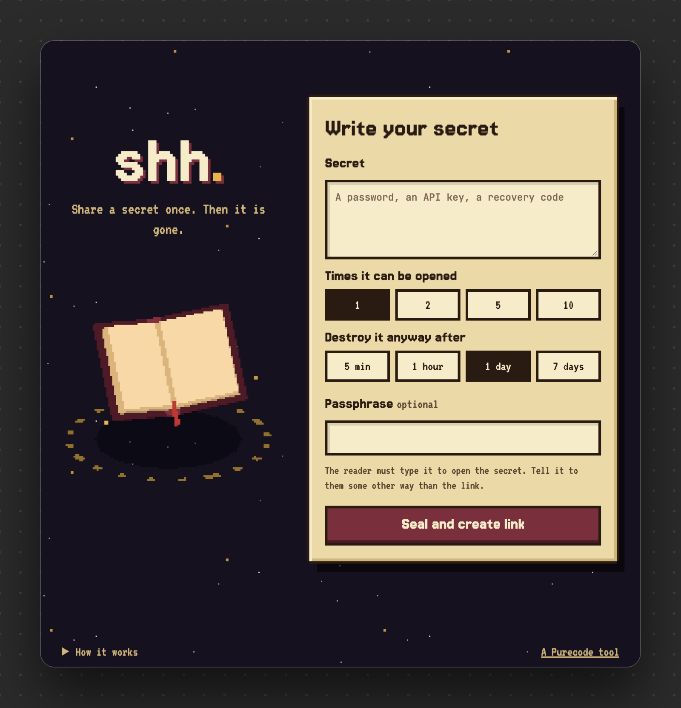
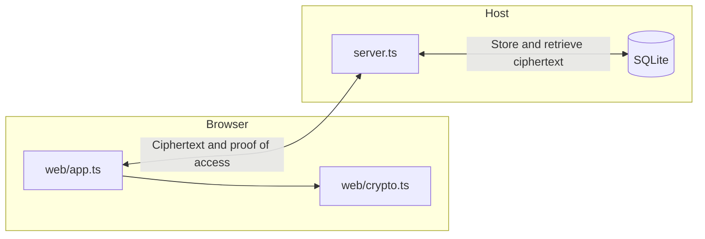

# shh

<p align="center"><a href="https://preacherxp.github.io/30-days-of-tools/"></a></p>

<p align="center"><a href="https://buymeacoffee.com/michal.hachula"></a></p>

shh shares passwords and other text secrets through encrypted links that expire and open once by default.

Paste a secret at [shh.purecode.sh](https://shh.purecode.sh/), choose when it expires, and send the generated link to your recipient. The browser encrypts the text before it is uploaded and keeps the decryption key in the part of the link after `#`.

<p align="center"></p>

## Requirements

- A modern browser with Web Crypto and JavaScript enabled.
- [Bun](https://bun.sh/) 1.4.4 or later to build and self-host.

## Install

```sh
git clone https://github.com/preacherxp/shh.git
cd shh
bun install --frozen-lockfile
bun run build
bun run start
```

Open [http://127.0.0.1:3000](http://127.0.0.1:3000). To update, pull the latest changes, repeat the install and build, and restart the server. To uninstall, stop the server and remove the checkout and any SQLite file you configured.

## Usage

1. Paste the text in **Secret**. Choose how many times the link can open and when it expires.
2. By default, the link opens once and expires in five minutes. Leave **Passphrase** blank to generate a random one, or enter your own. Select **Seal and create link**. Send the link and passphrase through separate channels where you can verify the recipient.
3. The recipient opens the link, enters the passphrase, and selects **Reveal secret**. Loading the page does not use an open. The key leaves the address bar immediately; after refreshing, reopen the original link. Previously issued links without a passphrase still work.
4. Select **Clear now** when finished. The revealed text also clears after 60 seconds. Neither action erases clipboard copies.

| Key | Action |
| --- | --- |
| `⌘Enter` / `Ctrl+Enter` in the secret field | Seal and create a link |

## Configuration

| Environment variable | Default | Purpose |
| --- | --- | --- |
| `PORT` | `3000` | HTTP port |
| `SHH_HOST` | `127.0.0.1` | Address to listen on |
| `SHH_DB` | In memory | SQLite file path if links should survive a restart |
| `SHH_TRUST_PROXY` | Disabled | Set to `1` only behind a trusted proxy that controls `X-Forwarded-For` and prevents direct access to Bun |

For remote access, put shh behind HTTPS on its own hostname. The browser needs a secure context, and the app uses paths relative to the root.

## Limits

- Secrets are text only, up to 16 KiB encoded as UTF-8. Links expire after 5 minutes, 1 hour, 1 day, or 7 days.
- Anyone who receives both the link and its passphrase can read the secret. Five wrong attempts destroy the stored secret. For privileged credentials, prefer individual accounts or password-manager sharing tied to the recipient's identity.
- Recipients can save or forward plaintext. Deleting the stored ciphertext cannot remove those copies.
- You must trust the host and any TLS-terminating proxy or CDN: each can change the JavaScript that handles passwords. Self-host with HTTPS terminating on your own server if you do not want to extend that trust to a CDN.

## Architecture



- `web/crypto.ts` uses Web Crypto for AES-GCM; the link carries the key material in its fragment, not in an HTTP request.
- `server.ts` stores ciphertext and enforces expiration, open counts, and attempt limits. It does not write request logs.
- `web/scene.ts` renders the vault in a worker that does not receive the secret or link.

## Development

```sh
bun run typecheck
bun test
bun run build
```

The build writes the browser bundles and copies static assets to `dist/`. The Bun server needs that directory but does not need `node_modules` at runtime.

## License

[MIT](LICENSE)

<sub>If it keeps a password out of your chat history, you can [buy me a coffee](https://buymeacoffee.com/michal.hachula).</sub>
