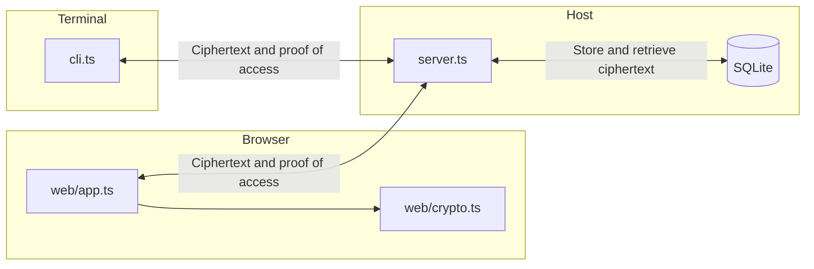

# shh

<p align="center"><a href="https://preacherxp.github.io/30-days-of-tools/"></a></p>

<p align="center"><a href="https://buymeacoffee.com/michal.hachula"></a></p>

shh shares passwords and other text secrets through encrypted links that expire and open once by default.

Paste a secret at [shh.purecode.sh](https://shh.purecode.sh/), choose when it expires, and send the generated link to your recipient. The browser encrypts the text before it is uploaded and keeps the decryption key in the part of the link after `#`.

<p align="center"></p>

## Requirements

- A modern browser with Web Crypto and JavaScript enabled.
- [Bun](https://bun.sh/) 1.4.4 or later to build and self-host, and to run the command line client. Comparing a build with a live site needs exactly the pinned version; see [Verify the live site](#verify-the-live-site).

## Install

```sh
git clone https://github.com/preacherxp/shh.git
cd shh
bun install --frozen-lockfile
bun run build
bun run start
```

Open [http://127.0.0.1:3000](http://127.0.0.1:3000). To update, pull the latest changes, repeat the install and build, and restart the server; an existing SQLite file is brought up to date in place when the server starts. To uninstall, stop the server and remove the checkout and any SQLite file you configured.

## Usage

1. Paste the text in **Secret**. Choose how many times the link can open and when it expires.
2. By default, the link opens once and expires in five minutes. Leave **Passphrase** blank to generate a random one, or enter your own. Select **Seal and create link**. Send the link and passphrase through separate channels where you can verify the recipient.
3. Keep the **sender's private link** shown next to them, and do not send it. It shows whether the secret was opened, how often and when, and its **Destroy now** button removes the secret at once, opened or not. It cannot open the secret. The same status and button stay on the page while the tab is open.
4. The recipient opens the link, enters the passphrase, and selects **Reveal secret**. Loading the page does not use an open. The key leaves the address bar immediately; after refreshing, reopen the original link. Previously issued links without a passphrase still work.
5. Select **Clear now** when finished. The revealed text also clears after 60 seconds. Neither action erases clipboard copies.

| Key | Action |
| --- | --- |
| `⌘Enter` / `Ctrl+Enter` in the secret field | Seal and create a link |
| `Esc` in the shield panel | Close it |

A few sentences under the button say why it is safe to paste a secret, and the shield in the corner of the page opens the detail in two groups. **Checked in your browser just now** lists what the page tested about itself a moment ago, each marked passed, failed or not checked. **How shh works** lists facts about the code that the page cannot test from the inside. Neither proves that the page was served unaltered; the next two sections are for that.

### Command line client

`cli.ts` does the same encryption with the same code as the page and talks to the same server, without loading any JavaScript from it. Run it from a clone after `bun install --frozen-lockfile`:

```sh
printf %s "$TOKEN" | bun cli.ts send --expires 1h --opens 2
bun cli.ts open
bun cli.ts status
bun cli.ts destroy
bun cli.ts --help
```

- `send` reads the secret from standard input, never from an argument, and prints three labelled lines: the recipient link, a generated passphrase and the sender's private link. `--passphrase` asks for your own without echo. `--url` selects another server; the default is `https://shh.purecode.sh`, and anything but HTTPS is refused except `http://localhost` and `http://127.0.0.1`.
- `open` asks for the link and then the passphrase without echo, and prints only the secret to standard output. When standard input is piped, it reads the link from the first line and the passphrase from the second. A link given as an argument also works, but it stays in the shell history and shows in the process list.
- `status` and `destroy` take the sender's private link the same way. `destroy` asks for confirmation unless `--yes` is given.
- Exit codes: `0` done, `1` failed, `2` wrong usage, `3` wrong passphrase, `4` gone, expired or destroyed. The hidden prompts need a terminal on macOS or Linux.

Links made by the client open in the page, and links made by the page open in the client. To build a single executable that includes Bun:

```sh
bun build --compile cli.ts --outfile shh
./shh --help
```

### Verify the live site

Browser-side encryption is only as good as the JavaScript the site serves. This command builds the checkout in a temporary directory, fetches every built file from the site with a plain GET, and compares SHA-256 hashes:

```sh
bun scripts/verify-live.ts
```

It prints one line per file with `match` or `DIFFER` and both hashes, then the security headers it received and any proxy or CDN that named itself in the response headers, and exits with `0` only if every file matched. Pass another address to check your own deployment, for example `bun scripts/verify-live.ts http://127.0.0.1:3000`.

The build is reproducible: the same input gives the same bytes on macOS and Linux and in any directory. For the comparison to be valid, these must match the deployment:

- **The commit.** Check out the commit that was deployed, with no local changes. The script prints the commit it built.
- **The dependencies.** Install with `bun install --frozen-lockfile`, so three.js and the fonts are the versions in `bun.lock`.
- **The Bun version.** Exactly the one in `packageManager` in `package.json` (1.4.4), because Bun's bundler writes the JavaScript. The script warns when yours differs.

A mismatch means the site is not serving what that commit builds. The usual cause is harmless: the repository has moved on and the site has not been redeployed, or one of the three items above differs. It is also what you would see if a proxy rewrote a file or someone changed what is served, and the script cannot tell these apart. Until a mismatch is explained, use the command line client instead of the page. A match covers what the site sent to your machine at that moment; a host could still serve something else to another visitor.

## Configuration

| Environment variable | Default | Purpose |
| --- | --- | --- |
| `PORT` | `3000` | HTTP port |
| `SHH_HOST` | `127.0.0.1` | Address to listen on |
| `SHH_DB` | In memory | SQLite file path if links should survive a restart |
| `SHH_TRUST_PROXY` | Disabled | Set to `1` only behind a trusted proxy that controls `X-Forwarded-For` and prevents direct access to Bun |

For remote access, put shh behind HTTPS on its own hostname. The browser needs a secure context, and the app uses paths relative to the root.

### Rate limits behind a proxy

Each client address gets 30 new links an hour and 120 API calls a minute. An address is one IPv4 address or one IPv6 /64. Which address shh sees depends on what is in front of it:

- **Nothing in front, or `SHH_TRUST_PROXY` unset:** the address of whoever opened the connection. Behind a proxy that is the proxy itself, so all visitors share one allowance.
- **One reverse proxy and `SHH_TRUST_PROXY=1`:** shh uses the last entry of `X-Forwarded-For` and ignores the rest, which a visitor can forge. This is the real client when the proxy faces the internet directly and writes the address of whoever connected to it as the last entry, by overwriting the header or appending to it. Caddy does this by default. Bun must be reachable only through the proxy, or anyone can write the header.
- **A CDN in front of that proxy:** whoever connects to the proxy is now the CDN, so the last entry is a CDN address and every visitor arriving through that address shares one allowance. Telling the proxy to trust the CDN's ranges is not enough: Caddy with `trusted_proxies` keeps the CDN's entries and still appends the CDN's own address last. The proxy must work out the visitor's address from what the CDN sent and write it as the only entry. In Caddy that takes `trusted_proxies` with the CDN's ranges in the server options, either `trusted_proxies_strict` or `client_ip_headers` naming the CDN's own header, and `header_up X-Forwarded-For {client_ip}` in `reverse_proxy`.

The sender's status view asks the server every 5 seconds at first, then every 15, then once a minute, only while its tab is visible. Those calls count toward the 120 a minute, so a shared allowance runs out sooner.

## Limits

- Secrets are text only, up to 16 KiB encoded as UTF-8. Links expire after 5 minutes, 1 hour, 1 day, or 7 days.
- Anyone who receives both the link and its passphrase can read the secret. Five wrong attempts destroy the stored secret. For privileged credentials, prefer individual accounts or password-manager sharing tied to the recipient's identity.
- Recipients can save or forward plaintext. Deleting the stored ciphertext cannot remove those copies.
- Anyone who holds the sender's private link can see the status and destroy the secret. They cannot read it. A secret created before sender links existed has none.
- After the last open, a destroy, or five wrong passphrases, the ciphertext is overwritten in the database file, and a small record stays until the time the link would have expired: how it ended, how many times it was opened, and when the first open, the last open and the end happened. It holds no addresses and nothing else about the reader. Overwriting does not reach backups or snapshots taken while the secret was stored, or disk blocks the filesystem has not reused.
- The server can hold 10,000 secrets, and those records count toward that until they expire.
- You must trust the host and any TLS-terminating proxy or CDN: each can change the JavaScript that handles passwords. Self-host with HTTPS terminating on your own server if you do not want to extend that trust to a CDN.
- The command line client removes that trust for the person who runs it: the code that encrypts comes from the checkout, not from the server. It changes nothing for a recipient who opens the link in a browser. You still trust the copy of the client you run, and the server and its proxies still see ciphertext, timing and addresses, and can refuse or delete a secret.

## Architecture



- `web/crypto.ts` uses Web Crypto for AES-GCM; the link carries the key material in its fragment, not in an HTTP request. `cli.ts` imports the same file.
- `server.ts` stores ciphertext and enforces expiration, open counts, and attempt limits. It keeps only a hash of the access proof and of the sender's token, and it does not write request logs.
- `web/links.ts` holds the two link formats and the wording of a status, shared by the page and the client. `web/checks.ts` holds the shield's checks.
- `web/scene.ts` renders the vault in a worker that does not receive the secret or link.

## Development

```sh
bun run typecheck
bun test
bun run build
bun run test:browser
```

The build writes the browser bundles and copies static assets to `dist/`. The Bun server needs that directory but does not need `node_modules` at runtime. `bun run test:browser` drives an installed Chrome through the whole flow against the build and is skipped when no Chrome is found; `bun test` does not run it.

Two GitHub workflows run on the repository: `ci.yml` runs the typecheck, the tests and the build on every push and pull request, and `verify-live.yml` runs `bun scripts/verify-live.ts` against the live site once a day. That one fails whenever the default branch is ahead of what is deployed. To report a vulnerability, see [SECURITY.md](SECURITY.md).

## License

[MIT](LICENSE)

<sub>If it keeps a password out of your chat history, you can [buy me a coffee](https://buymeacoffee.com/michal.hachula).</sub>
